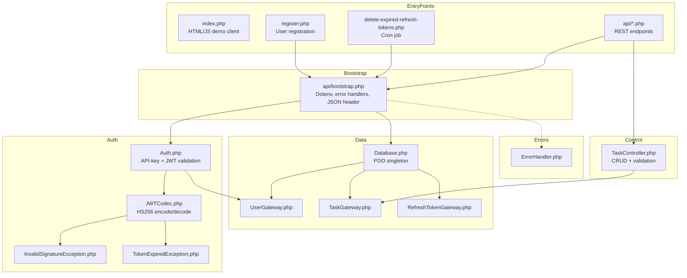

# Architecture — rest-api-php

## Overview
A RESTful task-management API with JWT-based authentication, written in PHP 8.0+. The repository also contains a minimal HTML/JS client (`index.php`) that demonstrates the API.

## Stack
| Layer | Technology |
|-------|------------|
| Language | PHP ≥ 8.0 (constructor promotion, typed properties, union types) |
| Database | MySQL / MariaDB via PDO (charset utf8, emulated prepares off) |
| Config | `vlucas/phpdotenv` v5.5.0 (^5.4) |
| Auth | Hand-rolled HS256 JWT in `src/JWTCodec.php`; access tokens 20 s, refresh tokens 5 days |
| Dependencies | `firebase/php-jwt` v7.0.0 declared but **unused**; `roave/security-advisories` dev-only |
| Frontend | Pico.css (CDN), vanilla JS (`index.php`) |
| Web server | Apache (`api/.htaccess` front-controller) or PHP built-in server |
| Testing | None |
| CI/CD | None |
| Container | None |

## Module Diagram


## Request Flow (API)
1. `api/bootstrap.php` loads `.env`, sets exception handlers, forces `Content-Type: application/json`.
2. Router in `api/index.php` parses `/api/tasks[/{id}]`, instantiates `Database`, `UserGateway`, `JWTCodec`, `Auth`.
3. `Auth::authenticateAccessToken()` validates `Authorization: Bearer <jwt>` via `JWTCodec::decode()` (signature + expiry).
4. On success, `Auth::getUserID()` returns the subject (`sub` claim).
5. `TaskController` receives the method + optional ID, delegates to `TaskGateway` (user-scoped queries).
6. Responses are JSON with appropriate HTTP status codes.

## Auth Flow
- **Registration** (`register.php`): creates user row, returns `api_key` (32 hex chars from `random_bytes(16)`).
- **Login** (`api/login.php`): verifies password (`password_verify`), issues access token (20 s) + refresh token (5 days) via `tokens.php` → `JWTCodec::encode()`.
- **Access**: `api/index.php` requires valid access token (JWT). `api/refresh.php` exchanges a valid refresh token (checked against `refresh_token` table) for a new pair.
- **Logout** (`api/logout.php`): deletes the refresh token from the table.
- **Cron** (`delete-expired-refresh-tokens.php`): purges expired rows.

## Database Schema (from `query.sql`)
```sql
-- tasks
id INT PK, name VARCHAR(128), priority INT NULL, is_completed BOOLEAN, user_id INT FK→users(id)

-- users
id INT PK, name VARCHAR(128), username VARCHAR(128) UNIQUE, password_hash VARCHAR(255), api_key VARCHAR(32) UNIQUE

-- refresh_token
token_hash CHAR(64) PK (HMAC-SHA256 of raw token), expires_at INT UNSIGNED INDEX
```
Indexes: `tasks(name)`, `tasks(user_id)`, `users(username)`, `users(api_key)`, `refresh_token(expires_at)`.

## Notable Code Patterns
- **Constructor property promotion** everywhere (`private string $host`, etc.).
- **Dependency injection** by hand: `Database` → gateways → controllers.
- **Prepared statements** with explicit `PDO::PARAM_*` binding.
- **`hash_equals`** for timing-safe JWT signature comparison.
- **Commented-out code** in `TaskGateway` (non-user-scoped CRUD) and `Auth` (base64 fallback).

## Gaps / Unconfirmed
- No migrations — schema only in `query.sql`.
- No transactions used (single-statement operations only).
- No N+1 risk today (flat queries), but `getAllForUser` + per-task fetches could become one.
- `ErrorHandler` exposes file/line in 500 responses (information leak).
- Access token TTL of 20 seconds is extremely short (likely a dev value).
- `ORDER BY 'name'` uses a string literal → no actual sorting (bug).